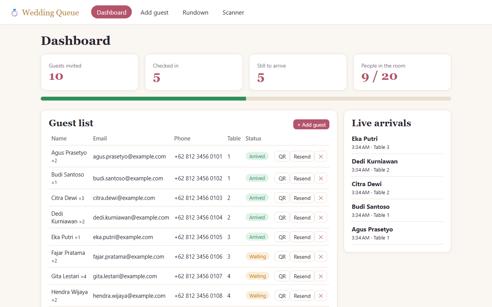
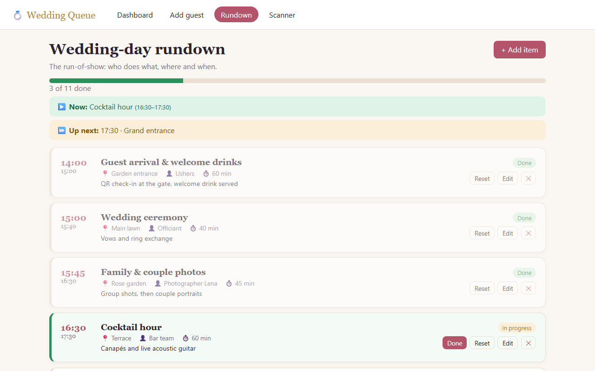
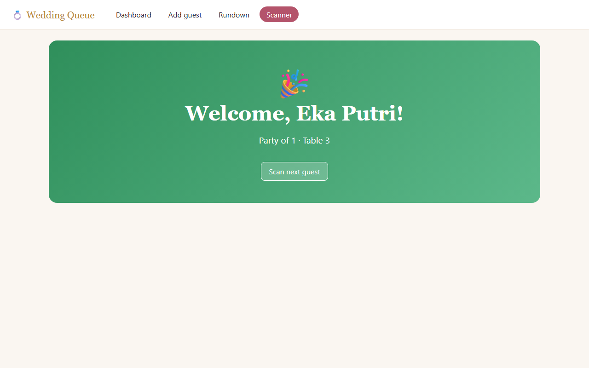
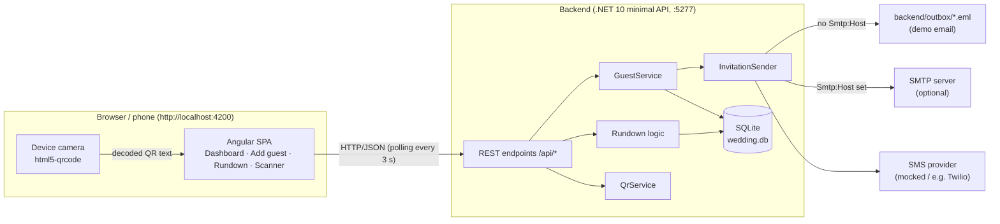
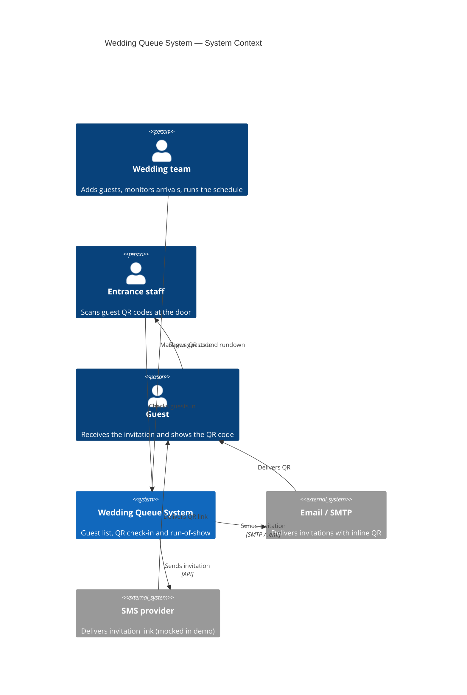
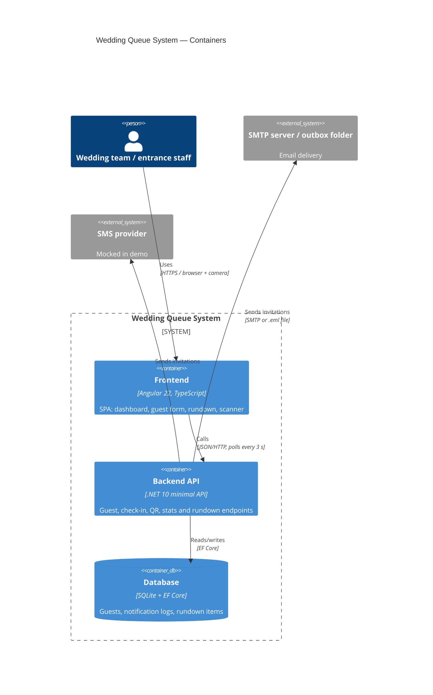
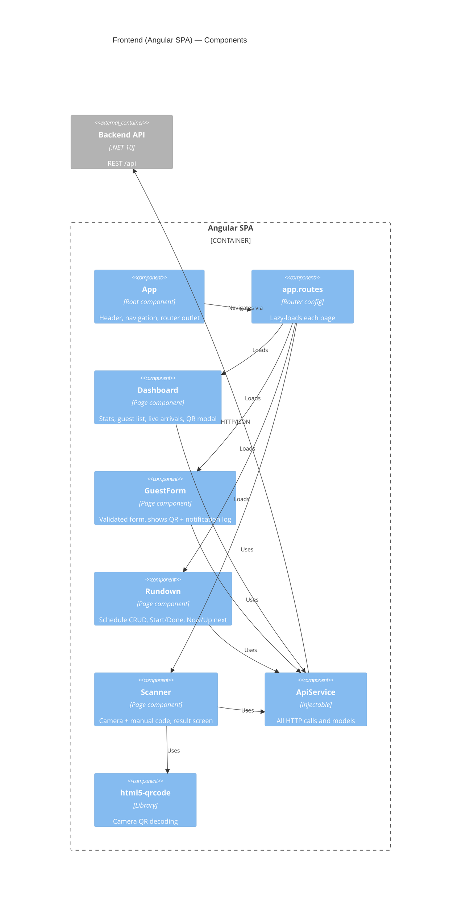

# Wedding Queue — Frontend

Angular 22 single-page app used by the wedding team to manage guests, check them in at the entrance by QR code, and run the wedding-day schedule. It talks to the .NET backend in [`../backend`](../backend) over a REST API.

## Screenshots

| Dashboard | Rundown | Scanner |
|---|---|---|
|  |  |  |

- **Dashboard** — live stats, guest list and arrivals.
- **Rundown** — the wedding-day schedule with Now / Up next.
- **Scanner** — the welcome screen shown after a successful QR check-in.

## Tech stack

| Area | Choice |
|---|---|
| Framework | Angular 22, standalone components (no NgModules) |
| State | Angular signals (`signal`, `computed`) |
| Forms | Template-driven forms (`FormsModule`) |
| HTTP | `HttpClient` via `provideHttpClient()` |
| Routing | Lazy-loaded routes (`loadComponent`) |
| QR scanning | [`html5-qrcode`](https://github.com/mebjas/html5-qrcode) |
| Tests | Vitest + jsdom (`ng test`) |
| Styling | Component-scoped CSS plus global theme variables in `src/styles.css` |

## Getting started

Prerequisites: Node.js and npm, plus the backend running on `http://localhost:5277`.

```bash
# 1. Start the backend (separate terminal)
cd ../backend
dotnet run --urls http://localhost:5277

# 2. Start the frontend
cd frontend
npm install
npm start            # same as: ng serve  ->  http://localhost:4200
```

The app reloads automatically when you change a source file.

> The API base URL is the `API_URL` constant in [`src/app/api.service.ts`](src/app/api.service.ts) (`http://localhost:5277/api`). Change it there if the backend runs elsewhere.

## Pages

| Route | Component | Purpose |
|---|---|---|
| `/` | `Dashboard` | Live overview and guest list |
| `/guests/new` | `GuestForm` | Add a guest and send their invitation |
| `/rundown` | `Rundown` | Wedding-day run-of-show |
| `/scanner` | `Scanner` | Entrance check-in by camera or typed code |
| `**` | — | Redirects to `/` |

### Dashboard (`/`)
- Four stat tiles: guests invited, checked in, still to arrive, and people in the room (`arrived / expected`, which counts party sizes).
- A progress bar showing the share of guests checked in.
- Guest table with name, party size, email, phone, table and an *Arrived / Waiting* badge.
- Per-guest actions: **QR** (opens a modal with the QR image and its text code, plus **Reset check-in** if the guest has arrived), **Resend** the invitation, and **Delete** (with confirmation).
- A **Live arrivals** sidebar listing the most recent check-ins.
- Auto-refreshes every 3 seconds (guests and stats are fetched together with `forkJoin`); the timer is cleared when the page is destroyed. If the server is unreachable it shows a banner asking whether the backend is running.

### Add guest (`/guests/new`)
- Fields: name (required), email (required, valid format), phone (required, min 7 characters), table (optional), party size (1–20).
- On submit the backend creates the guest and sends the invitation by email and SMS. The page then shows the created guest's QR code and the notification log (channel, recipient, status) so you can confirm delivery.
- The form resets after a successful save; validation errors show once a field is touched or the form is submitted.

### Rundown (`/rundown`)
- The run-of-show for the day: start time, duration, title, description, location and owner.
- Add, edit and delete items; backend validation errors (HTTP 400) are shown on the form.
- Each item moves through **Upcoming → In progress → Done** using the *Start*, *Done* and *Reset* buttons.
- Overall progress (`n of m done`) with a progress bar, a **Now** banner for the item in progress and an **Up next** banner for the first pending item.

### Scanner (`/scanner`)
- Starts the device camera (rear-facing preferred) and decodes QR codes continuously at 10 fps.
- Camera access requires `localhost` or HTTPS. If the camera is unavailable, a message appears and the **manual code** input remains available (the code is shown under the QR in the dashboard's QR dialog).
- Each scan calls `POST /api/checkin` and shows a full-screen result for 6 seconds, or until **Scan next guest** is pressed:
  - **Green** — welcome, with party size and table.
  - **Amber** — the QR was already scanned ("Welcome back").
  - **Red** — code not recognised, or the server could not verify it.
- A `busy` flag prevents duplicate submissions while a request or result is on screen. The camera is stopped and timers are cleared when leaving the page.

## Project structure

```
frontend/
├── src/
│   ├── main.ts                  # bootstrapApplication entry point
│   ├── index.html
│   ├── styles.css               # global theme variables and shared classes (.card, .btn, .badge ...)
│   └── app/
│       ├── app.ts               # root component: header, nav, <router-outlet>
│       ├── app.config.ts        # providers: HttpClient, Router, global error listeners
│       ├── app.routes.ts        # lazy-loaded routes with page titles
│       ├── api.service.ts       # ApiService, API_URL and all TypeScript models
│       └── pages/
│           ├── dashboard.ts
│           ├── guest-form.ts
│           ├── rundown.ts
│           └── scanner.ts
├── angular.json
└── package.json
```

Each page is a single standalone component file with its template and styles inline. Spec files (`*.spec.ts`) sit next to the code they test in `src/app/`.

## System architecture



### C4 — Level 1: System context



### C4 — Level 2: Containers



### C4 — Level 3: Frontend components



## Architecture notes

- **One API service.** [`ApiService`](src/app/api.service.ts) is the only place that builds URLs and calls `HttpClient`. It also defines the models: `Guest`, `GuestInput`, `Stats`, `CheckInResult`, `NotificationLog`, `RundownItem`, `RundownInput` and `RundownStatus`.
- **Signals for state.** Components hold data in signals and derive values with `computed` (for example the progress percentage, or the *Now* and *Up next* rundown items).
- **Lazy loading.** Each page is its own chunk, so the scanner library is only downloaded when `/scanner` is opened.
- **Polling, not websockets.** The dashboard polls every 3 seconds to stay "live".
- **Test hooks.** Elements carry `data-testid` attributes (for example `stat-total`, `row-<id>`, `manual-code`, `welcome`) that the unit tests and the Playwright suite in [`../e2e`](../e2e) rely on. Keep them when refactoring templates.

## API endpoints used

| Method | Endpoint | Used for |
|---|---|---|
| GET | `/api/guests` | Guest list |
| POST | `/api/guests` | Create guest and send invitation |
| DELETE | `/api/guests/{id}` | Delete guest |
| POST | `/api/guests/{id}/resend` | Resend invitation |
| POST | `/api/guests/{id}/reset-checkin` | Undo a check-in |
| GET | `/api/guests/{id}/notifications` | Email/SMS delivery log |
| GET | `/api/stats` | Dashboard totals and recent arrivals |
| POST | `/api/checkin` | Check in by QR code |
| GET | `/api/qr/{code}.png` | QR image |
| GET / POST | `/api/rundown` | List / add rundown items |
| PUT / DELETE | `/api/rundown/{id}` | Edit / delete an item |
| POST | `/api/rundown/{id}/status` | Set item status |

## Scripts

| Command | What it does |
|---|---|
| `npm start` | Dev server at `http://localhost:4200` |
| `npm run build` | Production build into `dist/` |
| `npm run watch` | Development build that rebuilds on change |
| `npm test` | Unit tests with Vitest |

## Testing

```bash
npx ng test --watch=false     # unit tests (API service, dashboard, guest form, rundown, scanner)
```

End-to-end tests live in [`../e2e`](../e2e) (Playwright) and start both servers against a fresh database:

```bash
cd ../e2e
npx playwright test
```

## Troubleshooting

- **"Cannot reach the server"** on the dashboard — the backend is not running on port 5277, or `API_URL` points elsewhere.
- **Camera does not start** — use `http://localhost:4200` or HTTPS, and allow camera permission; otherwise type the code manually.
- **New rundown data missing** — delete `backend/wedding.db` once so the schema is recreated (see the root README).

## Author

**nandoz** (Hernando Ivan Teddy)

## Further reading

- Project overview and backend: [`../README.md`](../README.md)
- [Angular CLI reference](https://angular.dev/tools/cli)
